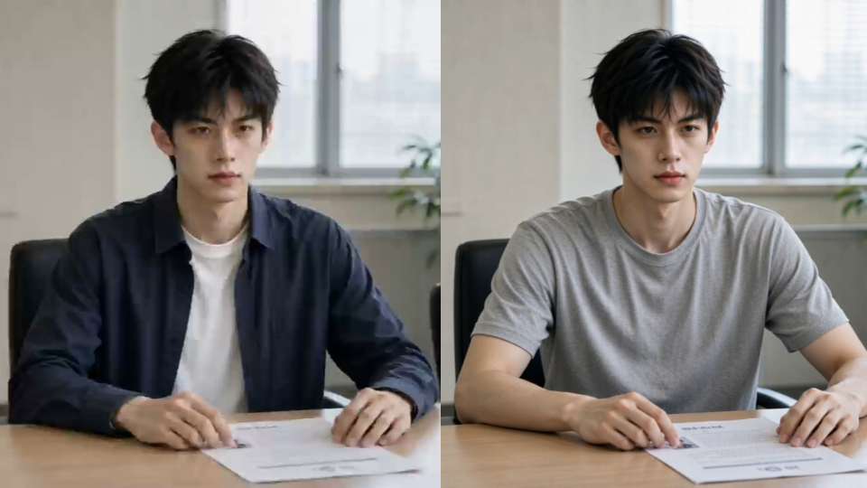

# 平行时空的你

同一个人，相同的大学起点。在两个平行世界里，511与513因日常选择的不同，逐渐走向不同的人生轨迹。

**四个古风小生 · 2026 WaytoAGI 1024 AI短剧参赛作品**

## 完整版

影片约 **3分05秒**，分辨率 **2560 × 1440**。

完整版作为 **Release附件** 提供，文件名为 parallel-you-full-1440p.mp4。打开仓库右侧的 **Releases** 即可下载。视频体积较大，因此与剧本、提示词等仓库资料分开存放。

## 故事

511与513拥有相同的面孔与起点。大学四年里，他们对拖延、失败、学习与求助做出的回应，逐渐留下不同的痕迹。

影片以面试切入，回到大学生活中的关键选择，再以项目资料和简历呼应开头。编号 **511＋513＝1024** 与赛事主题形成联系。

我们希望观众记住：**四年不能重来，下一步，仍然可以选择。**

## 创作资料

| 内容 | 文件 |
| --- | --- |
| 八场创作剧本 | [story-draft.md](docs/story-draft.md) |
| 42条镜头提示词与制作说明 | [shot-prompts.md](docs/shot-prompts.md) |
| AI工具分工与创作过程 | [process.md](docs/process.md) |
| 路演讲述与问答 | [defense.md](docs/defense.md) |
| 可编辑路演PPT | [presentation.pptx](docs/presentation.pptx) |
| 成片文件信息 | [film.json](docs/film.json) |
| 人物参考图与成片截图 | [assets](assets/) |
| 团队与素材说明 | [CREDITS.md](CREDITS.md) |

剧本、分镜和路演材料保留了创作阶段的设计，部分情节与最终剪辑不同。**42指镜头提示词数量，不代表42个已生成的视频镜头。**

校园空教室查询工具是剧本中的项目设定，本仓库没有把它作为团队实际开发的软件成果。

## AI工具分工

| 工具 | 已确认用途 |
| --- | --- |
| 千问 | 文案与脚本生成 |
| 豆包 | 主人公样貌与角色形象 |
| Codex | 分镜提示词、制作说明与路演材料整理 |
| WorkBuddy | 视频生成 |

本片包含AI生成的图像与视频。故事组织、人物反应、素材选择与最终表达由团队共同判断。

## 团队

**四个古风小生**

- yangqi（队长）
- Ryan
- 小🐟呆呆脑
- sunnan

四位成员按场次协作，每人负责两场。

## 使用与许可

本仓库目前用于作品展示与创作资料公开，暂未选择统一的开放许可证。公开可访问不等于授予任意转载、改编或商用的许可，具体复用请先联系团队。

音乐、音效、字体及工具输出中的相关权利，依各自适用条款处理。人物参考图和成片截图在本仓库中用于介绍本项目。

有关资料版本和已知限制，见 [CREDITS.md](CREDITS.md)。
